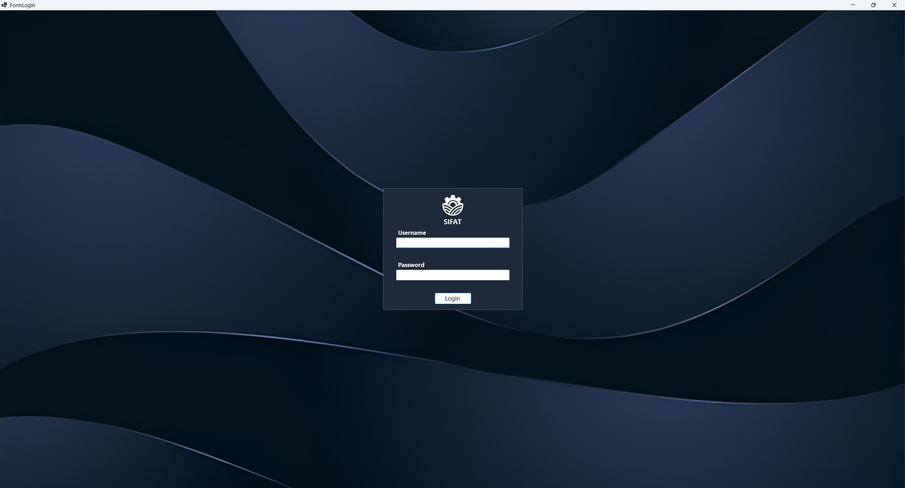
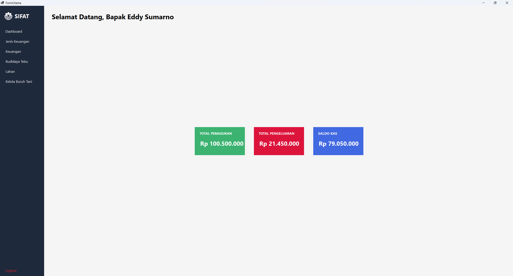
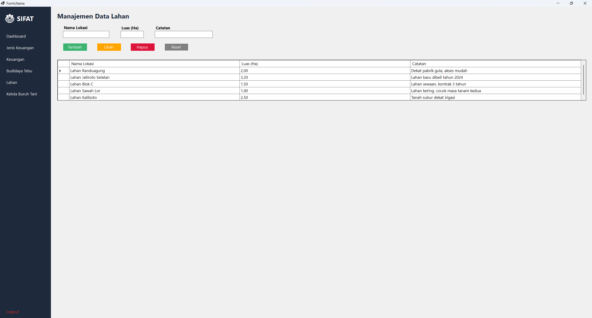
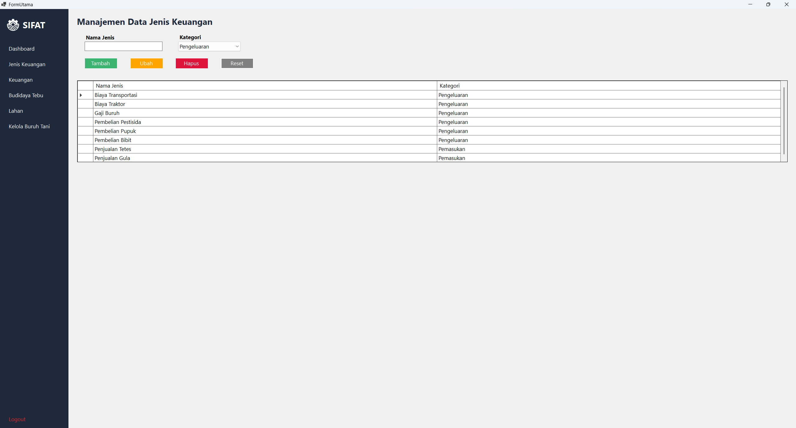
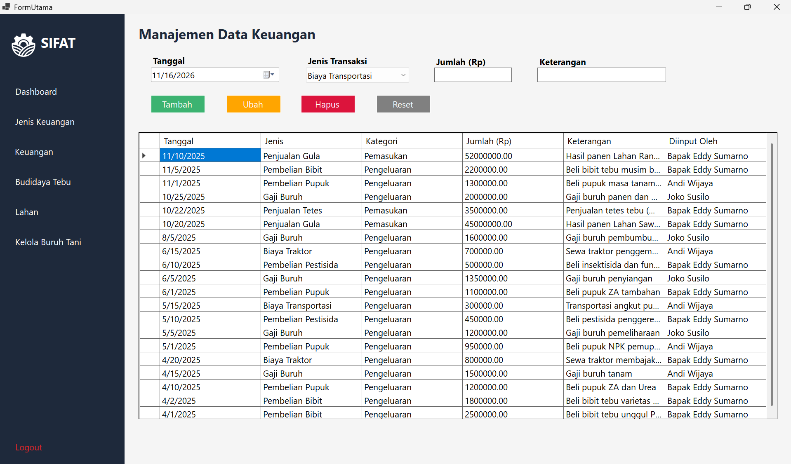
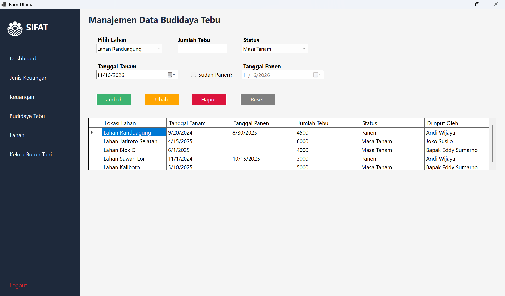
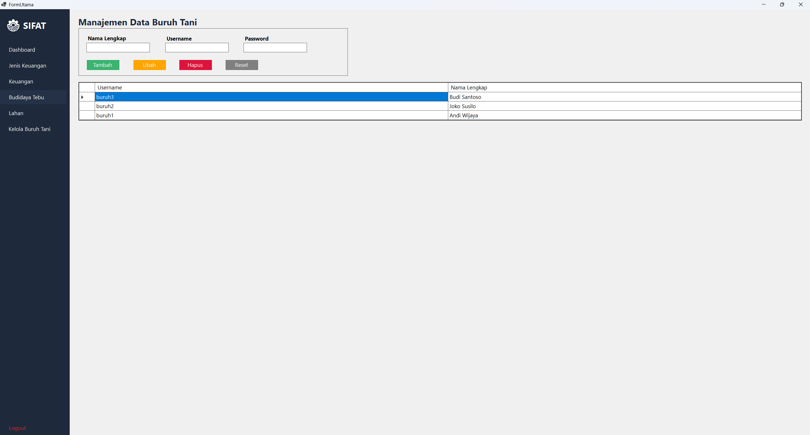

# SIFAT - System Finance and Tracking

SIFAT adalah aplikasi desktop berbasis **C# Windows Forms** yang dirancang khusus untuk membantu para pemilik lahan dan buruh tani dalam mengelola keuangan serta mencatat aktivitas budidaya tanaman tebu secara digital, rapi, dan terintegrasi.

Proyek ini dibangun sebagai pemenuhan **Tugas Akhir mata kuliah Pemrograman Berorientasi Objek (PBO)**.

## Fitur Utama

Aplikasi ini menerapkan sistem *Role-Based Access Control* (Hak Akses Berdasarkan Peran):

1. **Multi-User Login** (Pemilik Lahan dan Buruh Tani).
2. **Dashboard** (Ringkasan Total Pemasukan, Pengeluaran, dan Saldo Kas *real-time*).
3. **Manajemen Data Lahan** (Pencatatan lokasi dan luas lahan).
4. **Manajemen Jenis Keuangan** (Kategori Pemasukan & Pengeluaran).
5. **Manajemen Data Keuangan** (Buku kas harian dengan fitur CRUD).
6. **Manajemen Budidaya Tebu** (Pencatatan siklus tanam & panen).
7. **Kelola Buruh Tani** (Khusus Pemilik Lahan untuk mengelola akun karyawan).

## Teknologi & Arsitektur

- **Bahasa:** C# (.NET Windows Forms)
- **Database:** PostgreSQL
- **Library:** Npgsql
- **Arsitektur:** MVC (Model-View-Controller) & Repository Pattern
- **Konsep OOP:** Menerapkan 4 Pilar OOP (Encapsulation, Inheritance, Polymorphism, Abstraction)

---

## Tampilan Aplikasi

### 1. Halaman Login

Halaman masuk untuk Pemilik Lahan dan Buruh Tani dengan desain *Full Screen* dan *Card* elegan.



### 2. Halaman Dashboard

Menampilkan ringkasan total pemasukan, pengeluaran, dan saldo kas secara otomatis.



### 3. Manajemen Data Lahan

Halaman untuk mencatat daftar lahan yang dimiliki beserta luasnya.



### 4. Manajemen Jenis Keuangan

Halaman pengaturan kategori (Master Data) untuk transaksi keuangan.



### 5. Manajemen Data Keuangan

Halaman pencatatan uang masuk dan keluar beserta keterangannya.



### 6. Manajemen Budidaya Tebu

Halaman pencatatan tanggal tanam, jumlah tebu, dan status panen.



### 7. Manajemen Kelola Buruh Tani

Halaman untuk Pemilik Lahan mendaftarkan, mereset password, atau menonaktifkan akun Buruh Tani.



---

## Cara Menjalankan Proyek

1. **Buka Visual Studio Microsoft:**
   Buka aplikasi Visual Studio di komputermu.

2. **Clone Repositori:**
   * Pada halaman awal Visual Studio, pilih menu **"Clone a repository"**.
   * Masukkan URL repositori ini: 
   ```bash
   https://github.com/ardian79/SIFAT.git
   ```
   * Tentukan folder penyimpanan di komputermu, lalu klik **Clone**.

3. **Install Dependencies:**

   Buka *NuGet Package Manager* dan pastikan library **Npgsql** sudah terinstal.

4. **Siapkan Database:**

   - Buat database baru di PostgreSQL dengan nama `SIFAT`.
   - Jalankan script SQL yang terdapat pada file `database.sql`.

5. **Sesuaikan Koneksi:**

   Buka file `Database/Koneksi.cs` dan sesuaikan `Username` serta `Password` dengan pengaturan PostgreSQL di komputermu.

6. **Jalankan Aplikasi:**

   Tekan `F5` atau klik *Start* di Visual Studio.

## Tim Pengembang

- **Youhana Aulia Zahwa**
- **Felix Jericho Moniaga**
- **Rizal Lazuardi**
- **Muhammad Davin Ardiansyah**
- **Aji Pangestu**

---

*Dibuat untuk memenuhi Tugas Akhir Mata Kuliah Pemrograman Berorientasi Objek (PBO).*